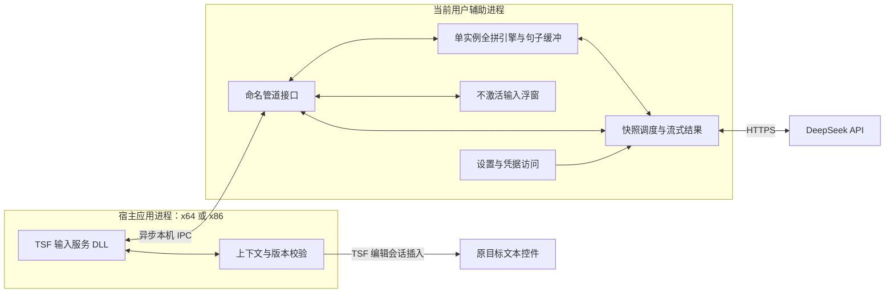

# 03 · 技术架构

## 1. 架构决策

采用 **原生 Windows TSF 输入服务 + 集中式本地全拼核心 + 独立桌面辅助进程**。2026-10-06 已落地 **C++20 + Win32 / DirectWrite / Direct2D**；Rime、草稿、浮窗和网络集中在一个用户辅助进程。设置页按需创建，HTTPS 使用后台工作线程中的 WinHTTP 调用，宿主线程不等待网络。工具链锁定为 llvm-mingw 20260922、CMake 4.4.4、Ninja 1.13.2。

WPF / .NET 只保留为快速验证交互的备选，不作为低占用发行版默认方案。原生方案减少运行时基线，但实际占用仍须测量，不能仅因使用 C++ 就宣称节省了某个具体比例。

已经有原生开发试用窗口、TSF DLL 和安装脚本；尚未进行系统注册与实际宿主验收。下文区分当前实现与继续验收的架构目标，实际状态以 [开发进度](08-开发进度与运行说明.md) 为准。网页仅作设计参考，原生程序不嵌入浏览器运行时。



## 2. 组件与职责

| 组件 | 职责 | 边界 |
|---|---|---|
| `Ime.Tsf` | COM 注册、输入配置、键盘事件、上下文、光标定位、最终插入 | 不能执行网络请求，不能等待讲解 |
| `Ime.Core`（辅助进程内） | 本地全拼、候选、句子缓冲、编辑操作、快照版本 | 不持久化句子内容，不持有 Key |
| `Companion` | 原生浮窗、按需设置、连接状态、API 与异步调度 | 不通过模拟按键写入宿主文档 |
| `Contracts` | IPC 消息、字段约束、协议版本、错误码 | 跨 x86 / x64，禁止传进程内指针 |
| `Installer` | 安装、输入配置注册、卸载和修复 | 不主动替换系统默认输入法 |
| `Validation` | 兼容性用例、性能基准、质量样例 | 仅使用合成样例，不采集真实用户输入 |

## 3. TSF 接入

原型需覆盖 `ITfTextInputProcessorEx`、`ITfKeyEventSink`、`ITfThreadMgrEventSink`、必要的文本布局 / 上下文通知，并通过 `ITfInputProcessorProfiles` / 输入配置管理接口注册语言配置。

文本插入必须通过有效的 TSF 编辑会话完成，例如 `ITfContext::RequestEditSession` 配合编辑 cookie 与插入接口。工作线程或管道回调不得直接调用属于宿主线程的 COM 接口。

### 组合与提交

本方案优先使用输入服务管理的外置句子缓冲：拼音和已选词显示在自绘浮窗中，用户确认前不向宿主插入中文再回删。利用 TSF 上下文和原插入点跟踪本次输入；需要建立何种 composition 状态、如何与不同宿主的文本服务行为兼容，应在 M1 实验中确定。

如果某类宿主必须依赖文档内 composition 才能正确协作，不能静默改成“先输入中文再替换”。应记录不兼容点，先解决外置缓冲路线；确需改变用户可见行为时，作为产品变更重新确认。

提交顺序：

1. 核对 active session、目标上下文、线程归属、内容版本。
2. 中文提交先接受当前选中候选，冻结最终中文。英文提交要求无待确认拼音、结果完整且匹配当前内容。
3. 在宿主线程请求写入编辑会话。异步请求同时处理请求返回值和实际编辑回调结果。
4. 插入指定字符串，不附加换行或模拟 Enter。
5. 成功后销毁草稿、翻译和讲解；失败保留当前仍有效的草稿并显示错误，不重复插入。

禁止用全局剪贴板、`SendInput`、自动 Backspace 或跨程序文本替换作为正常提交路径。

## 4. 全拼引擎

已采用 **librime 1.17.0**，复用拼音转换、候选和分词能力，自行实现 TSF 外壳及界面。不承诺与微软拼音词库、排序和智能纠错完全一致。

- librime 的仓库许可证为 BSD 三条款；仍需保留许可和版权声明。
- 当前采用 `rime-pinyin-simp` 词典（Apache-2.0），没有使用 `rime-luna-pinyin`。预编译 Rime 内含 octagram（GPL-3.0），不因方案未启用插件就忽略其分发义务；见第三方说明。
- 锁定可追溯的引擎、方案和词库版本；分发前生成第三方清单、许可文件和对应来源。
- 不直接复制其他输入法外壳、商用词库或未经确认可分发的词典。
- 默认禁用会持久化输入内容的用户词库学习 / 同步；用合成句检查引擎目录，确保“不保存输入”实际成立。
- 引擎初始化、词典部署和 I/O 在键盘输入路径之外完成；键盘响应不等待安装、解压或网络。
- 第一次激活时可短暂显示准备状态；未准备完成不吞键并卡住宿主。
- 当前登录会话的辅助进程只初始化一份引擎，多个宿主通过 IPC 连接；宿主 DLL 不加载 Rime。候选、字符串和快照有明确上限。
- 引擎在辅助进程启动时初始化；宿主 DLL 自身仍有内存与线程成本。跨宿主总增量是 M1 的必测项，详见性能文档。

## 5. 句子缓冲模型

下面为扩展模型。Alpha 实际采用 `InputBuffer` 的 `revision`、`display_revision`、`result_revision` 和随机 `session` 校验；没有实现独立 `sourceHash`、`configRevision` 或内部文本选区。编辑光标与 Unicode 字符边界已实现。

```text
InputSession
  sessionId           本次文本上下文会话的随机标识
  contextGeneration   上下文重新绑定时递增
  documentCookie      仅宿主进程内使用，不通过 IPC 传指针
  confirmedText       用户已确认的中文片段
  caret / selection   内部草稿的光标和选区
  composingPinyin     当前拼音段
  candidatePreview    引擎当前候选的中文预览
  sourceText          已确认部分与当前候选预览合成的文本
  sourceRevision      sourceText 的实际内容改变时递增
  uiRevision          光标、候选确认状态等 UI 改变时递增
  sourceHash          对精确 sourceText 计算的本机会话摘要
  configRevision      模型 / 提示词配置版本
  translation         当前或最近完成的结果及其绑定版本
  explanation         绑定当前完整英文的讲解
```

选词确认前的最佳候选可作为翻译预览输入，并在中文区标记未确认。英文提交只有在拼音段为空且结果匹配当前源文本时才允许。若确认候选不改变 `sourceText`，可以沿用同一内容版本的完整结果，不必重复请求。

任何对正文、标点或词序的修改都使之前的提交权限失效。仅移动光标不触发翻译。

## 6. 浮窗与进程通信

### 浮窗

Win32 浮窗设置 `WS_EX_NOACTIVATE`，正确响应 `WM_MOUSEACTIVATE`，结合 `ShowWindow` 的不激活方式显示。中文编辑、光标和选区采用 DirectWrite / Direct2D 可控绘制；鼠标点击回传定位命令，键盘仍由 TSF 接收。Direct2D 只在失效区域有变化时绘制，不启动常驻逐帧渲染循环；高对比度等场景提供适配。

必须验证：候选点击不失焦、讲解展开不失焦、多显示器 DPI、工作区边缘、输入框滚动、系统文本缩放和 UI Automation。自绘不能省略可访问名称、候选项语义与屏幕阅读支持。

### IPC

- 每个登录用户运行一个 Companion，允许多个宿主连接，按 active session 路由界面。
- 使用本机命名管道，用户 SID 限制 DACL、拒绝远程连接、校验对端进程 / 会话身份。
- 消息采用长度前缀 UTF-8 JSON，首版最大帧 64 KiB；`protocolVersion` 用于兼容判断。
- 发送快照不阻塞键盘线程。队列有界，过时的待发送快照可合并为最新一条。
- UI 点击命令必须附带 session 和 revision；Core 重新检查，不能相信 UI 的旧状态。
- 新连接通过版本握手获取当前快照；不同版本不盲目解析。

Alpha 实际协议：公共字段 `v:1`；消息为 `hello`、`ready`、`key`、`state`、`commit`、`ack`、`committed`、`end`。按键消息携带 `session`、递增 `seq`、`vk`、修饰键和光标屏幕坐标；提交握手携带 `session` 和 `revision`。UI 与 Core 在同一线程内直接调用，不额外走 `ui.command` 管道。下方是未来扩展的快照协议示意，不是当前可直接发送的报文。

```json
{
  "protocolVersion": 1,
  "type": "source.snapshot",
  "sessionId": "session-uuid",
  "contextGeneration": 7,
  "sourceRevision": 42,
  "uiRevision": 51,
  "sourceText": "我今天累坏了，想早点睡。",
  "hasPendingPinyin": false,
  "configRevision": "translation-v1"
}
```

消息最少包含：`session.start`、`source.snapshot`、`session.end`、`translation.chunk`、`translation.complete`、`translation.error`、`explanation.result`、`ui.command`、`health.status`。消息中无 Key；错误对象中无完整请求正文。

## 7. 崩溃、失焦与安全输入

- Companion 退出不能把宿主带崩。管道回调异常隔离；但当前 Core 与草稿在辅助进程内，进程退出会丢失未提交草稿，不能承诺此时仍可 Enter 提交。
- 候选服务不可用时停止捕获新的拼音。Alpha 需切换输入法或重新打开试用窗口恢复；自动恢复是后续工作。
- 宿主退出或文本上下文变更，立即结束会话并停止向该目标提交。
- 密码、安全输入模式及禁止文本服务的控件，不捕获或翻译内容。结合 TSF 输入范围和上下文属性判定，按目标控件能力回退；无法可靠判定的敏感场景进入兼容性缺口清单。
- 普通进程和提升权限程序之间存在完整性级别边界；单用户普通权限辅助进程不保证覆盖管理员应用。单独验证，不能通过放宽管道权限或常驻管理员进程掩盖问题。
- 不把进程内存中的敏感文本写入崩溃转储和默认日志。诊断仅记录匿名错误码、耗时和应用版本等非内容信息。

## 8. 凭据、配置与安装

API Key 已固定使用 Windows Credential Manager，凭据名 `EShuRu/DeepSeek`。`%LOCALAPPDATA%\EShuRu\settings.json` 仅存主题与紧凑布局；同目录 `rime` 保存方案元数据，关闭用户词库学习。

```text
安装目录
  EShuRu.exe      x64 辅助进程 / 设置 / 开发试用窗口
  EShuRuTip.dll   x64 TSF 桥接
  rime.dll        x64 集中式引擎
  x86/EShuRuTip.dll  x86 TSF 桥接，连接同一个 x64 辅助进程
  data/           只读拼音方案与词库
  licenses/       第三方许可与来源
用户配置目录
  settings.json   无 Key、无输入正文
```

Alpha 使用 PowerShell 安装 / 注销脚本，系统执行尚未验证；正式安装包工具再评估 WiX。需要继续处理升级、已加载 DLL 与重启、二进制和安装包签名。当前没有登录启动项。

当前注销脚本默认保留安装文件，`-RemoveFiles` 才清理固定安装目录；配置与凭据保留，用户可在设置中先删除 Key。正式安装包需明确这些选项。不能删除系统其他输入法、Rime 的共享目录或其他用户数据。

## 9. 建议源码结构

以下是原始模块目录规划；Alpha 实际以平铺的 `src/*.cpp` 实现这些职责，完整文件映射见第 8 份文档：

```text
src/
  Ime.Tsf/              原生 COM 输入服务
  Ime.Core/             本地全拼与句子会话
  Companion/            Win32 / DirectWrite 界面、设置、异步 API
  Contracts/            协议 schema 和共享定义
installer/
tests/
  core/                 编辑、版本、提交不变量
  integration/          TSF 与 IPC
  quality/              合成语料与口语评审
  performance/          延迟和持续输入
docs/
design/
```
